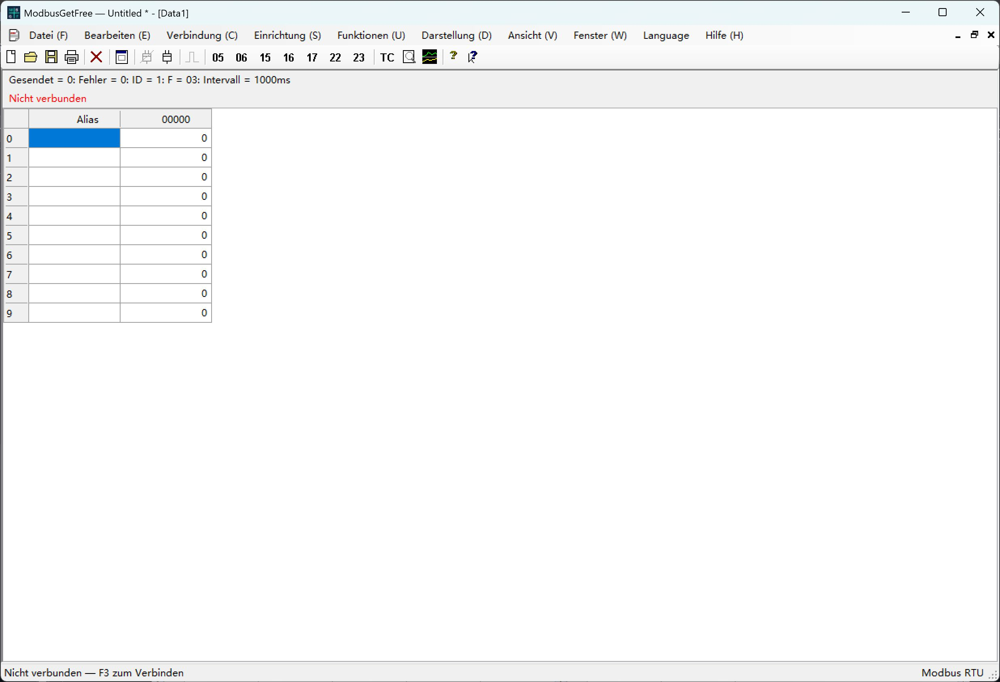

# ModbusGetFree

[English](README.md) | [简体中文](README.zh-CN.md) | [Español](README.es.md) | [Français](README.fr.md) | [Русский](README.ru.md) | [Português](README.pt.md) | [Polski](README.pl.md) | [日本語](README.ja.md) | [Deutsch](README.de.md) | [한국어](README.ko.md)

Modbus-RTU-Desktopwerkzeug für Windows, entwickelt mit C# / Windows Forms. Modbus Poll dient als Vorbild.

Design: Jim NI. Copyright © 2026 Jim NI. [MIT-Lizenz](LICENSE).

## Hauptfenster

Das Bild zeigt die deutsche Oberfläche vor dem Verbindungsaufbau.

## Sprachen

Die Standardsprache ist **Englisch**. Im Menü **Language** vor dem Hilfemenü stehen Englisch, vereinfachtes Chinesisch, Spanisch, Französisch, Russisch, Portugiesisch, Polnisch, Japanisch, Deutsch und Koreanisch zur Auswahl. Die Auswahl bleibt beim nächsten Start erhalten.

## Starten und Erstellen

Starten Sie `ModbusGetFree.exe`. Zum Erstellen führen Sie `./build.ps1` in PowerShell mit dem Windows-.NET-Framework-Compiler aus. Der C#-Quellcode liegt in `src`.

## Funktionen

- Serielle RTU-Verbindung, unabhängige Datenfenster und Demo-Slave ohne Hardware.
- Zyklische Abfragen mit FC01/02/03/04 und Bedienfenster für FC05/06/15/16/17/22/23.
- Manuelles Senden wartet auf den Abschluss der laufenden Transaktion und pausiert neue Abfragen am gemeinsam genutzten Port. Nach Antwort, Fehler oder Zeitüberschreitung werden die Abfragen fortgesetzt. Der Timer läuft weiter; ausgefallene Abfragen werden nicht nachgeholt. Broadcast-Schreibzugriffe warten nicht auf eine Antwort.
- Schreiben von Spulen und Registern, AND/OR-Masken, kombiniertes Lesen/Schreiben und datentypabhängige Bearbeitung.
- Anzeigeformate, Skalierung, Schriftarten, Farben, Diagramme, Verkehrsaufzeichnung und Testcenter.
- `.mpdoc`-Dokumente, `.mprtu`-Arbeitsbereiche und Import unterstützter `.mbp`-Archive der Versionen V7.x/V9.x.

## Tests und Dokumentation

`./test-ui-regression.ps1` prüft Oberfläche und Sprachen; `./test.ps1` enthält auch RTU-Tests. Die Tests verwenden den Demo-Slave und schreiben nicht auf Hardware. Die Hilfe ist in die Anwendung integriert. Details zu Importgrenzen, Ressourcen und Tests stehen in der [englischen README](README.md).

## GitHub

Tragen Sie die HTTPS-Projektadresse für den Info-Dialog in `github-repository.txt` ein.

## Automatische Updates

Aktivieren Sie Updates unter **Hilfe → Über ModbusGetFree** (standardmäßig aus). Wählen Sie sofortiges Update, Download im Hintergrund mit Anwendung beim nächsten Start oder diesmal überspringen. Die Hintergrundauswahl gilt nur für diese Sitzung. [Update- und Veröffentlichungsanleitung](UPDATES.md) (Englisch/Chinesisch).

GitHub wird nur einmal pro Programmstart geprüft. Bei einem Verbindungsfehler oder einer Zeitüberschreitung erfolgt in dieser Sitzung keine erneute Verbindung und kein weiterer Versuch. Der nächste Versuch erfolgt beim nächsten Programmstart. Die serielle Kommunikation bleibt unbeeinträchtigt.
