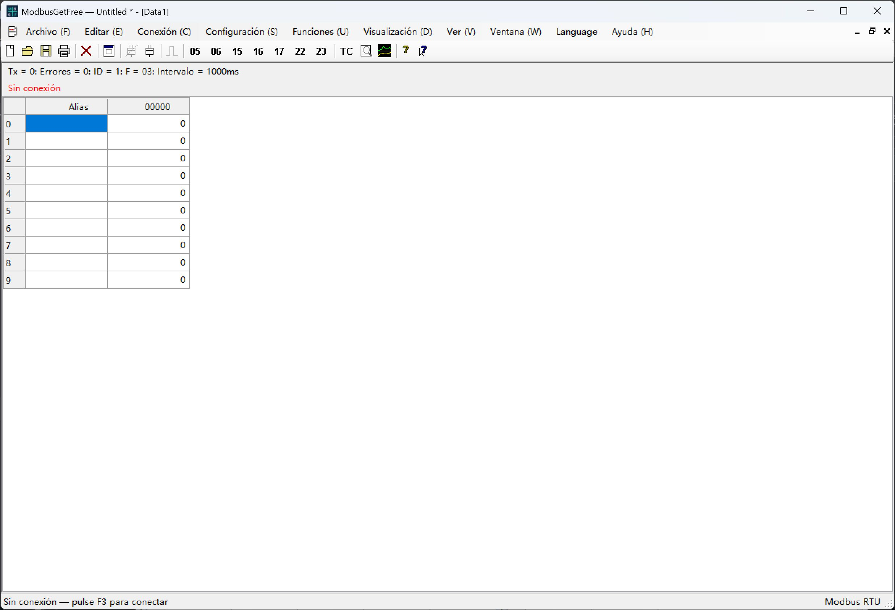

# ModbusGetFree

[English](README.md) | [简体中文](README.zh-CN.md) | [Español](README.es.md) | [Français](README.fr.md) | [Русский](README.ru.md) | [Português](README.pt.md) | [Polski](README.pl.md) | [日本語](README.ja.md) | [Deutsch](README.de.md) | [한국어](README.ko.md)

Herramienta de escritorio Modbus RTU para Windows, desarrollada en C# / Windows Forms, con Modbus Poll como referencia.

Diseño: Jim NI. Copyright © 2026 Jim NI. Licencia [MIT](LICENSE).

## Ventana principal

La captura muestra la interfaz en español antes de conectar.

## Idiomas

El idioma predeterminado es **inglés**. El menú **Language**, situado antes de Ayuda, permite elegir inglés, chino simplificado, español, francés, ruso, portugués, polaco, japonés, alemán o coreano. La selección se guarda para el siguiente inicio.

## Uso y compilación

Ejecute `ModbusGetFree.exe`. Para compilar, ejecute `./build.ps1` en PowerShell con el compilador de Windows .NET Framework. El código C# está en `src`.

## Funciones

- Conexión serie RTU, ventanas de datos independientes y esclavo de demostración sin hardware.
- Consulta periódica FC01/02/03/04 y operaciones FC05/06/15/16/17/22/23.
- Los envíos manuales esperan a que termine la transacción actual y suspenden las nuevas consultas del puerto compartido. La consulta se reanuda tras la respuesta, el error o el tiempo de espera. El temporizador sigue funcionando y no se acumulan consultas pendientes. Las escrituras de difusión no esperan respuesta.
- Escritura de bobinas y registros, máscaras AND/OR, lectura/escritura combinada y edición por tipo de dato.
- Formatos de visualización, escala, fuentes, colores, gráficos, captura de tráfico y centro de pruebas.
- Documentos `.mpdoc`, espacios de trabajo `.mprtu` e importación de archivos `.mbp` V7.x/V9.x compatibles.

## Pruebas y documentación

`./test-ui-regression.ps1` ejecuta las comprobaciones de interfaz e idiomas; `./test.ps1` incluye las pruebas RTU. Las pruebas utilizan un esclavo de demostración y no escriben en hardware. La ayuda está integrada en la aplicación. Consulte el [README en inglés](README.md) para los detalles de importación, recursos y pruebas.

## GitHub

Configure la URL HTTPS del proyecto en `github-repository.txt` para el cuadro Acerca de.

## Actualizaciones automáticas

Active las actualizaciones en **Ayuda → Acerca de ModbusGetFree** (desactivadas por defecto). Puede actualizar ahora, descargar en segundo plano para aplicar al iniciar de nuevo, u omitir esta vez. La elección de segundo plano solo vale para esta sesión. [Instrucciones de actualización y publicación](UPDATES.md) (inglés/chino).

GitHub se comprueba solo una vez por inicio. Si la conexión falla o se agota el tiempo de espera, no se reconecta ni se reintenta durante esta sesión; se intentará de nuevo al iniciar el programa la próxima vez. La comunicación serie no se ve afectada.
