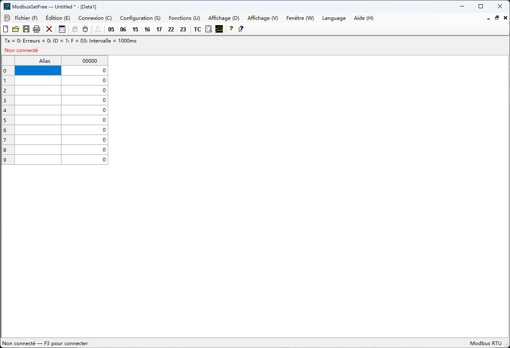

# ModbusGetFree

[English](README.md) | [简体中文](README.zh-CN.md) | [Español](README.es.md) | [Français](README.fr.md) | [Русский](README.ru.md) | [Português](README.pt.md) | [Polski](README.pl.md) | [日本語](README.ja.md) | [Deutsch](README.de.md) | [한국어](README.ko.md)

Utilitaire de bureau Modbus RTU pour Windows, écrit en C# / Windows Forms, avec Modbus Poll comme référence.

Conception : Jim NI. Copyright © 2026 Jim NI. Licence [MIT](LICENSE).

## Fenêtre principale

La capture montre l’interface en français avant la connexion.

## Langues

La langue par défaut est **l’anglais**. Le menu **Language**, placé avant Aide, propose l’anglais, le chinois simplifié, l’espagnol, le français, le russe, le portugais, le polonais, le japonais, l’allemand et le coréen. Le choix est enregistré pour le prochain démarrage.

## Utilisation et compilation

Lancez `ModbusGetFree.exe`. Pour compiler, exécutez `./build.ps1` dans PowerShell avec le compilateur Windows .NET Framework. Les sources C# se trouvent dans `src`.

## Fonctions

- Connexion série RTU, fenêtres de données indépendantes et esclave de démonstration sans matériel.
- Interrogation périodique FC01/02/03/04 et opérations FC05/06/15/16/17/22/23.
- Un envoi manuel attend la fin de la transaction en cours et suspend les nouvelles interrogations du port partagé. Elles reprennent après la réponse, une erreur ou une expiration du délai. Le temporisateur continue de fonctionner, sans rattrapage des interrogations manquées. Les écritures en diffusion n’attendent pas de réponse.
- Écriture de bobines et de registres, masques AND/OR, lecture/écriture combinée et édition selon le type de données.
- Formats d’affichage, mise à l’échelle, polices, couleurs, graphiques, capture du trafic et centre de test.
- Documents `.mpdoc`, espaces de travail `.mprtu` et importation des archives `.mbp` V7.x/V9.x compatibles.

## Tests et documentation

`./test-ui-regression.ps1` vérifie l’interface et les langues ; `./test.ps1` inclut les tests RTU. Les tests utilisent un esclave de démonstration et n’écrivent pas sur du matériel. L’aide est intégrée. Le [README anglais](README.md) précise les limites d’importation, les ressources et les tests.

## GitHub

Renseignez l’URL HTTPS du projet dans `github-repository.txt` pour la boîte À propos.
