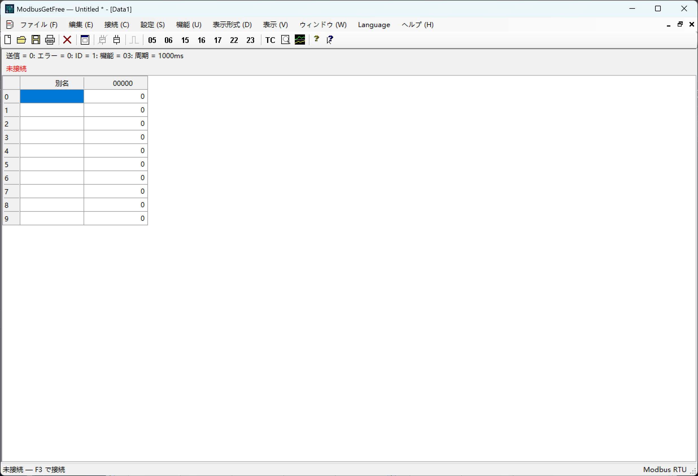

# ModbusGetFree

[English](README.md) | [简体中文](README.zh-CN.md) | [Español](README.es.md) | [Français](README.fr.md) | [Русский](README.ru.md) | [Português](README.pt.md) | [Polski](README.pl.md) | [日本語](README.ja.md) | [Deutsch](README.de.md) | [한국어](README.ko.md)

C# / Windows Forms で開発した Windows 用 Modbus RTU デスクトップツールです。Modbus Poll を参考にしています。

設計：Jim NI。Copyright © 2026 Jim NI。[MIT ライセンス](LICENSE)。

## ダウンロードと使用方法

**ソフトウェアを使用するだけなら、[Release フォルダー](Release/) の内容のみをダウンロードしてください。ソースコードとテストは不要です。** [GitHub の最新リリース](https://github.com/web110/ModbusGetFree/releases/latest) から `ModbusGetFree-update.zip` をダウンロードしてすべて展開し、`ModbusGetFree.exe` を実行できます。`assets` フォルダーは実行ファイルと同じ場所に置いてください。Windows .NET Framework 4.5 以降が必要です。

**自動更新機能**があります。**ヘルプ → ModbusGetFree について**で有効にしてください。GitHub への接続に失敗した場合、再試行は次回起動時に行います。

## メイン画面

画像は接続前の日本語のメイン画面です。

## 言語

既定の言語は **英語** です。ヘルプの前にある **Language** メニューで、英語、簡体字中国語、スペイン語、フランス語、ロシア語、ポルトガル語、ポーランド語、日本語、ドイツ語、韓国語を選択できます。選択内容は次回の起動時にも保持されます。

## 起動とビルド

`ModbusGetFree.exe` を実行します。ビルドする場合は、Windows .NET Framework コンパイラを使用して PowerShell で `./build.ps1` を実行します。C# ソースは `src` にあります。

## 機能

- シリアル RTU 接続、独立したデータウィンドウ、ハードウェア不要のデモ用スレーブ。
- FC01/02/03/04 のポーリングと FC05/06/15/16/17/22/23 の操作画面。
- 手動送信は現在の通信が完了するまで待機し、共有ポートの新しいポーリング要求を一時停止します。応答、エラー、タイムアウト後に元のポーリングを再開します。タイマーは動作を続け、実行できなかった要求をまとめて送信しません。ブロードキャスト書き込みは応答を待ちません。
- コイルとレジスタの書き込み、AND/OR マスク、読み書きの同時実行、データ型に応じた編集。
- 表示形式、スケーリング、フォント、色、グラフ、通信記録、テストセンター。
- `.mpdoc` データファイル、`.mprtu` ワークスペース、対応する V7.x/V9.x `.mbp` ファイルのインポート。

## テストとドキュメント

`./test-ui-regression.ps1` は画面と言語を検証し、`./test.ps1` は RTU テストも実行します。テストはデモ用スレーブを使用し、実機への書き込みは行いません。ヘルプはアプリに内蔵されています。インポートの制限、リソース、テストの詳細は [英語の README](README.md) を参照してください。

## GitHub

「バージョン情報」に表示するプロジェクトの HTTPS URL を `github-repository.txt` に設定してください。

## 自動更新

**ヘルプ → ModbusGetFree について** で更新を許可します（既定は無効）。新しいバージョンがある場合、今すぐ更新、バックグラウンドでダウンロードして次回起動時に適用、今回は更新しない、のいずれかを選択できます。バックグラウンド更新の選択は今回のみ有効です。[更新とリリースの手順](UPDATES.md)（英語・中国語）。

GitHub の確認は起動ごとに 1 回だけ行います。接続に失敗した場合やタイムアウトした場合、今回の実行中は再接続・再試行せず、次回起動時に再び確認します。シリアル通信には影響しません。
