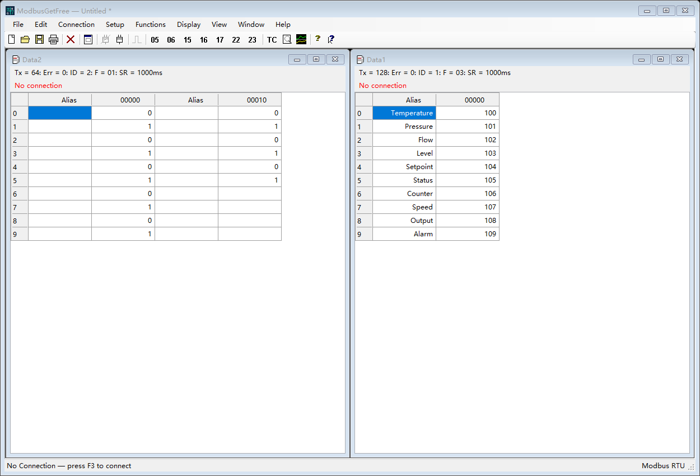

# ModbusGetFree

[English](README.md) | [简体中文](README.zh-CN.md) | [Español](README.es.md) | [Français](README.fr.md) | [Русский](README.ru.md) | [Português](README.pt.md) | [Polski](README.pl.md) | [日本語](README.ja.md) | [Deutsch](README.de.md) | [한국어](README.ko.md)

C# / Windows Forms로 개발한 Windows용 Modbus RTU 데스크톱 도구입니다. Modbus Poll을 참고했습니다.

설계: Jim NI. Copyright © 2026 Jim NI. [MIT 라이선스](LICENSE).

## 메인 화면

이미지는 예제 데이터를 표시한 영어 화면입니다.

## 언어

기본 언어는 **영어**입니다. 도움말 앞에 있는 **Language** 메뉴에서 영어, 중국어 간체, 스페인어, 프랑스어, 러시아어, 포르투갈어, 폴란드어, 일본어, 독일어, 한국어를 선택할 수 있습니다. 선택한 언어는 다음 실행 시에도 유지됩니다.

## 실행 및 빌드

`ModbusGetFree.exe`를 실행합니다. 빌드하려면 Windows .NET Framework 컴파일러를 사용하여 PowerShell에서 `./build.ps1`을 실행합니다. C# 소스는 `src`에 있습니다.

## 기능

- 직렬 RTU 연결, 독립 데이터 창, 하드웨어 없이 사용하는 데모 슬레이브.
- FC01/02/03/04 폴링 및 FC05/06/15/16/17/22/23 작업 창.
- 수동 전송은 현재 통신이 완료될 때까지 기다리고 공유 포트의 새 폴링 요청을 일시 중지합니다. 응답, 오류 또는 시간 초과 후 기존 폴링을 재개합니다. 타이머는 계속 작동하며 누락된 폴링을 몰아서 전송하지 않습니다. 브로드캐스트 쓰기는 응답을 기다리지 않습니다.
- 코일 및 레지스터 쓰기, AND/OR 마스크, 동시 읽기/쓰기, 데이터 형식에 따른 편집.
- 표시 형식, 배율, 글꼴, 색상, 차트, 통신 기록 및 테스트 센터.
- `.mpdoc` 문서, `.mprtu` 작업 공간, 지원되는 V7.x/V9.x `.mbp` 파일 가져오기.

## 테스트 및 문서

`./test-ui-regression.ps1`은 화면과 언어를 검사하며 `./test.ps1`은 RTU 테스트도 포함합니다. 테스트는 데모 슬레이브를 사용하며 하드웨어에 데이터를 쓰지 않습니다. 도움말은 앱에 내장되어 있습니다. 가져오기 제한, 리소스 및 테스트에 대한 자세한 내용은 [영어 README](README.md)를 참고하세요.

## GitHub

정보 창에 표시할 프로젝트 HTTPS URL을 `github-repository.txt`에 설정하세요.
