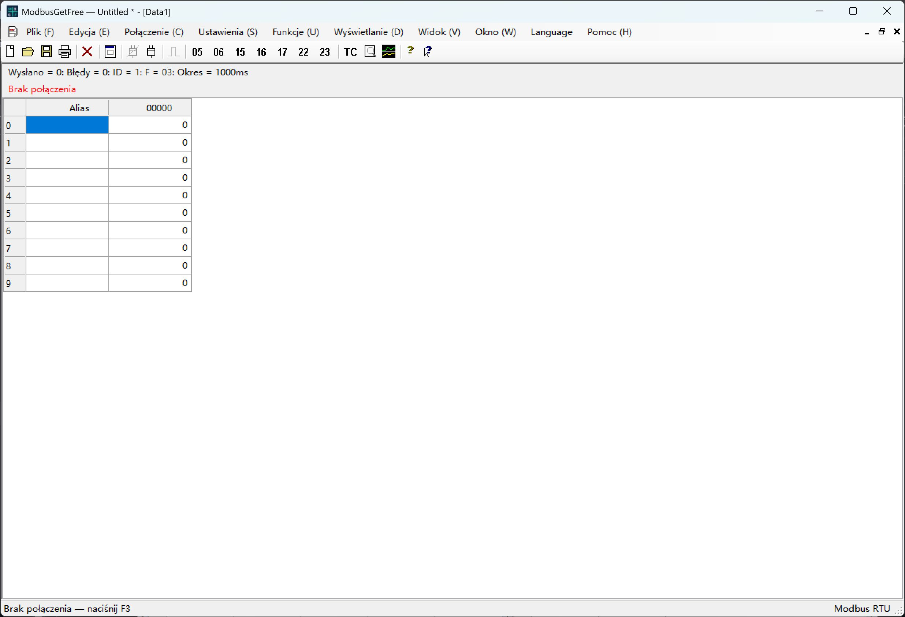

# ModbusGetFree

[English](README.md) | [简体中文](README.zh-CN.md) | [Español](README.es.md) | [Français](README.fr.md) | [Русский](README.ru.md) | [Português](README.pt.md) | [Polski](README.pl.md) | [日本語](README.ja.md) | [Deutsch](README.de.md) | [한국어](README.ko.md)

Narzędzie Modbus RTU dla Windows napisane w C# / Windows Forms, wzorowane na Modbus Poll.

Projekt: Jim NI. Copyright © 2026 Jim NI. Licencja [MIT](LICENSE).

## Pobieranie i używanie

**Aby korzystać z programu, wystarczy pobrać zawartość [folderu Release](Release/); kod źródłowy i testy nie są potrzebne.** Pobierz `ModbusGetFree-update.zip` z [najnowszego wydania GitHub](https://github.com/web110/ModbusGetFree/releases/latest), rozpakuj cały plik i uruchom `ModbusGetFree.exe`. Folder `assets` musi znajdować się obok programu. Wymagany jest Windows .NET Framework 4.5 lub nowszy.

Program obsługuje **automatyczne aktualizacje**, włączane w **Pomoc → O ModbusGetFree**. Nieudane połączenie z GitHub jest ponawiane dopiero przy następnym uruchomieniu.

## Okno główne

Zrzut przedstawia polski interfejs przed nawiązaniem połączenia.

## Języki

Domyślnym językiem jest **angielski**. Menu **Language**, przed menu pomocy, umożliwia wybór języka angielskiego, chińskiego uproszczonego, hiszpańskiego, francuskiego, rosyjskiego, portugalskiego, polskiego, japońskiego, niemieckiego lub koreańskiego. Wybór jest zapisywany na następne uruchomienie.

## Uruchamianie i kompilacja

Uruchom `ModbusGetFree.exe`. Aby skompilować program, wykonaj `./build.ps1` w PowerShell z kompilatorem Windows .NET Framework. Kod C# znajduje się w `src`.

## Funkcje

- Połączenie szeregowe RTU, niezależne okna danych i demonstracyjne urządzenie podrzędne bez sprzętu.
- Cykliczne odpytywanie FC01/02/03/04 oraz operacje FC05/06/15/16/17/22/23.
- Ręczne wysyłanie czeka na zakończenie bieżącej transakcji i wstrzymuje nowe zapytania na wspólnym porcie. Odpytywanie jest wznawiane po odpowiedzi, błędzie lub przekroczeniu czasu. Zegar nadal działa, a pominięte zapytania nie są nadrabiane. Zapis rozgłoszeniowy nie czeka na odpowiedź.
- Zapis cewek i rejestrów, maski AND/OR, jednoczesny odczyt i zapis oraz edycja według typu danych.
- Formaty wyświetlania, skalowanie, czcionki, kolory, wykresy, rejestrowanie ruchu i centrum testowe.
- Dokumenty `.mpdoc`, obszary robocze `.mprtu` i import zgodnych archiwów `.mbp` V7.x/V9.x.

## Testy i dokumentacja

`./test-ui-regression.ps1` sprawdza interfejs i języki; `./test.ps1` obejmuje testy RTU. Testy korzystają z urządzenia demonstracyjnego i nie zapisują danych w sprzęcie. Pomoc jest wbudowana w aplikację. Szczegóły importu, zasobów i testów zawiera [angielski README](README.md).

## GitHub

Wpisz adres HTTPS projektu do `github-repository.txt`, aby wyświetlać go w oknie informacji o programie.

## Automatyczne aktualizacje

Włącz aktualizacje w **Pomoc → O ModbusGetFree** (domyślnie wyłączone). Dostępne są: aktualizacja teraz, pobieranie w tle z instalacją przy następnym uruchomieniu oraz pominięcie tym razem. Wybór pobierania w tle dotyczy tylko bieżącej sesji. [Instrukcje aktualizacji i publikowania](UPDATES.md) (angielski/chiński).

GitHub jest sprawdzany tylko raz przy uruchomieniu. Jeśli połączenie nie powiedzie się lub upłynie limit czasu, program nie ponawia połączenia ani próby w tej sesji; kolejna próba nastąpi przy następnym uruchomieniu. Komunikacja szeregowa pozostaje bez zmian.
