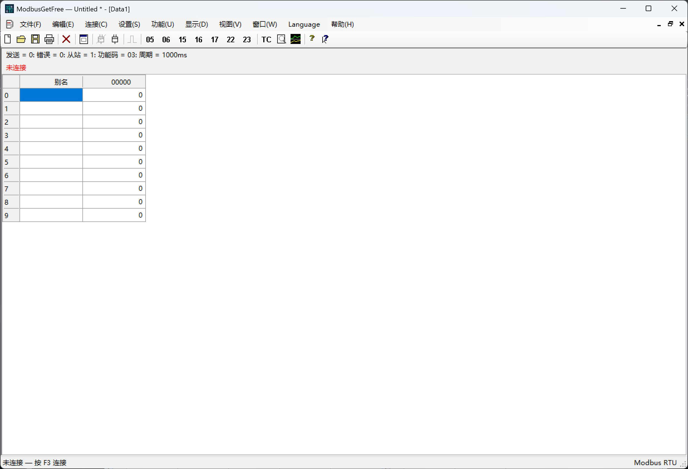

# ModbusGetFree

[English](README.md) | [简体中文](README.zh-CN.md) | [Español](README.es.md) | [Français](README.fr.md) | [Русский](README.ru.md) | [Português](README.pt.md) | [Polski](README.pl.md) | [日本語](README.ja.md) | [Deutsch](README.de.md) | [한국어](README.ko.md)

使用 C# / Windows Forms 编写的 Windows Modbus RTU 桌面工具。 参考Modbus Poll。

设计：Jim NI。版权所有 © 2026 Jim NI。采用 [MIT 许可证](LICENSE)。

## 主界面截图

截图为连接前的中文主界面。可通过 **Language** 切换界面语言。

## 界面语言

默认语言为 **英语**。通过 **Language** 可切换英语、简体中文、西班牙语、法语、俄语、葡萄牙语、波兰语、日语、德语、韩语。语言选择会自动保存，下次启动恢复；菜单快捷键及 Modbus 数据保持不变。

## 运行与构建

运行 `ModbusGetFree.exe` 即可启动。使用 PowerShell 执行 `./build.ps1`，通过 Windows .NET Framework 编译器构建。无需安装其他运行时包。可在 VS Code 中打开此文件夹，编辑 `src` 目录下的 C# 源文件。

## 功能

- 串口 RTU 连接、共享串口调度、独立数据窗口，以及无需硬件的演示从站。
- 支持 FC01/02/03/04 轮询，以及 FC05/06/15/16/17/22/23 操作窗口。
- 单次写入：选择线路功能码（05/15 或 06/16）、查看结果，并可选择在成功后关闭窗口。
- 批量写入：线圈勾选列表、寄存器值列表、28 种组合数据类型/字节序选项、类型化编辑，以及值列表的打开与保存。
- 功能码 05/06/15/16/17/22/23 手动发送会等待当前通信完整结束，期间暂停同一串口上所有窗口的新轮询请求，手动回复、错误或超时后恢复原轮询状态。调度定时器持续运行，到期轮询不会累计补发；广播写入无需等待回复。
- FC22：AND/OR 掩码，提供 32 个独立位控件。
- FC23：读写范围分别设置、类型化写入编辑，以及独立的读取结果。
- 独立显示格式、缩放、字体和颜色设置，以及图表、通信流量捕获和原始数据测试中心。
- 数据窗口可保存为 `.mpdoc`，工作区可保存为 `.mprtu`；支持导入 V7.x/V9.x `.mbp` 寄存器档案。支持导入 FC03/04 以及经验证的 16 位、float32 和 unsigned32 格式。不支持的布局或缩放设置会被拒绝。

应用程序内置“帮助主题”。本 README 是开发者文档，不会从应用程序的“帮助”菜单链接打开。

## 资源文件

原始 MBGF 四字母产品图标位于 `assets/branding`。`assets/icons/active` 中的工具栏 PNG 文件是可编辑的应用程序资源。本项目不包含提取的第三方图标、资源转储或比对文档。

## 测试

运行 `./test-ui-regression.ps1` 可执行界面和语言回归检查，涵盖 100 种语言切换组合、工具提示恢复、用户数据保持及语言设置保存。运行 `./test.ps1` 可执行含 RTU 协议测试的完整套件。测试使用独立的临时窗口和演示从站，不会向硬件写入数据。测试套件涵盖协议请求与验证、操作对话框、串口发现、显示格式、字体、图标和窗口行为。生成的可执行文件、日志和截图保存在按日期命名的 `tests/run` 子目录中，该目录已从 Git 中排除。`tests` 中的 `.cs` 文件是测试源代码，属于已发布项目的一部分。

## GitHub

“关于”对话框从 `github-repository.txt` 读取项目 URL。发布仓库后，请将此文件设置为对应的 HTTPS GitHub URL。请勿将凭据或用户项目文件放入此仓库。
